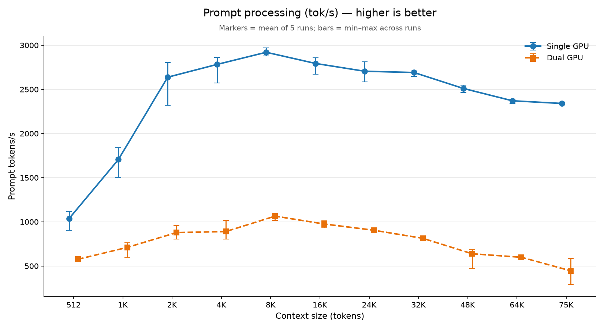
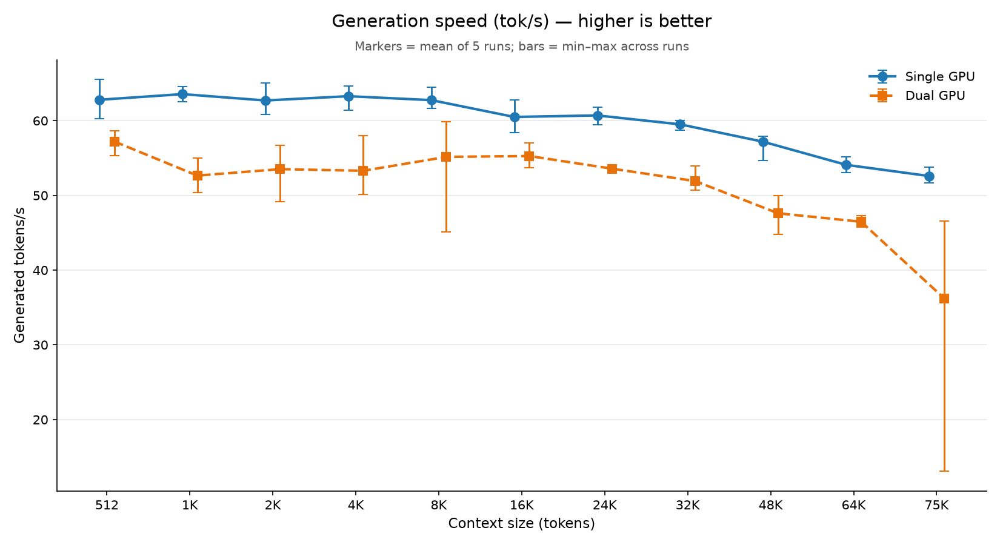

# llama.cpp RPC Server (CUDA)

Prebuilt Docker image of the llama.cpp RPC server with CUDA GPU acceleration, built from the same commit as the Windows `llama-server.exe` binary.

## Table of contents

- [Why this image](#why-this-image)
- [Hardware requirements](#hardware-requirements)
- [Image](#image)
- [Usage](#usage)
  - [Docker Run](#docker-run)
  - [Docker Compose (TrueNAS SCALE)](#docker-compose-truenas-scale)
  - [Windows Coordinator (example)](#windows-coordinator-example)
- [Dependencies (Windows coordinator)](#dependencies-windows-coordinator)
- [Benchmark results](#benchmark-results)
  - [Setup](#setup)
  - [What was tested](#what-was-tested)
  - [Full results](#full-results)
  - [Visual comparison](#visual-comparison)
  - [Key findings](#key-findings)
  - [Recommendation](#recommendation)
  - [Caveats](#caveats)
- [Benchmark your own setup](#benchmark-your-own-setup)
  - [Quick start](#quick-start)
  - [bench.py options](#benchpy-options)
  - [Compare output](#compare-output)
  - [Tips](#tips)
- [Building from source](#building-from-source)
- [Notes](#notes)

## Why this image

Prebuilt images from other users had version mismatches with the Windows `llama-server.exe` (build 11869), causing RPC connection crashes. This image is built from the exact same commit (`d327bf1f0`, tag `b11869`) to ensure compatibility. It also uses CUDA 12.4 — newer versions (12.6+) trigger forward compatibility errors on RTX 3070.

Enables distributed LLM inference across multiple GPUs on different machines. The RPC server exposes a TCP endpoint that the Windows `llama-server` coordinator connects to, offloading model inference to a secondary GPU.

## Hardware requirements

This Docker image runs on **any NVIDIA GPU with CUDA support** (Ampere architecture — sm_86 — and newer recommended, e.g. RTX 30-series and up). The llama.cpp build must match your Windows coordinator's build for RPC compatibility.

## Image

```
id0ntplaygam3s/rpc-b11869:latest
```

## Usage

### Docker Run

```bash
docker run -d \
  --name llama-rpc-worker \
  --gpus all \
  --restart unless-stopped \
  -p 50052:50052 \
  -v /path/to/models:/models:rw \
  id0ntplaygam3s/rpc-b11869:latest \
  -H 0.0.0.0 -p 50052
```

### Docker Compose (TrueNAS SCALE)

```yaml
services:
  llama-rpc:
    image: id0ntplaygam3s/rpc-b11869:latest
    container_name: llama-rpc-worker
    restart: unless-stopped
    ports:
      - "50052:50052"
    environment:
      - NVIDIA_VISIBLE_DEVICES=all
      - NVIDIA_DRIVER_CAPABILITIES=compute,utility
    command: ["-H", "0.0.0.0", "-p", "50052"]
```

### Windows Coordinator (example)

Connect to the RPC worker from your Windows `llama-server`:

```bash
llama-server.exe -m model.gguf --fit on --fit-ctx 128000 --fit-target 256 -np 1 -fa on -ub 2048 -ctk q8_0 -ctv q8_0 --rpc 192.168.0.xxx:50052
```

Don't set `-ngl` together with `--fit on`: `--fit` chooses the layer/tensor split across the local GPU and the RPC device automatically.

## Dependencies (Windows coordinator)

Download the following on your Windows machine:

### llama.cpp binaries (build 11869)
Get from the [official llama.cpp releases](https://github.com/ggerganov/llama.cpp/releases) — download the `llama-server-win-cuda.zip` for your build (build 11869 / commit `d327bf1f0`), or build from source:

```bash
git clone https://github.com/ggerganov/llama.cpp
cd llama.cpp && git checkout d327bf1f0
cmake -B build -DGGML_CUDA=ON
cmake --build build --config Release -j
```

- `llama-server.exe` — main inference server
- `llama.dll`, `llama-common.dll`, `llama-server-impl.dll` — runtime libraries
- `ggml.dll`, `ggml-base.dll`, `ggml-cuda.dll` — GGML backend (CUDA)
- `ggml-rpc.dll`, `ggml-rpc-server.exe` — RPC client/server
- CPU backend DLLs (`ggml-cpu-*.dll`) — fallback CPU inference
- `cublas64_13.dll`, `cublasLt64_13.dll`, `cudart64_13.dll` — NVIDIA CUDA libraries (included with CUDA 12.x or in the llama.cpp release zip)
- `libomp.dll` — OpenMP runtime (included with CUDA 12.x or in the llama.cpp release zip)

### Monitoring tools
- `hw-metrics.py` — hardware metrics sidecar (GPU, CPU, memory)
- `monitor.html` — browser dashboard
- `serve-dual-gpu-With-Monitoring.bat` — dual-GPU launch script (local + RPC)

### Python
- [Python 3.13+](https://www.python.org/downloads/) (or adjust the `PY` path in the bat files)

## Benchmark results

Single GPU is faster than dual-GPU over RPC at both prompt processing and generation on this hardware. Dual only makes sense when a model does not fit on one GPU.

### Setup

| Component | Details |
|-----------|---------|
| Coordinator GPU | NVIDIA GeForce RTX 5070 Ti (16 GB VRAM) |
| Coordinator CPU | AMD Ryzen 7 5700X3D (8 cores / 16 threads), 64 GB DDR4 3600 MHz |
| RPC Worker GPU | NVIDIA GeForce RTX 3070 (8 GB VRAM, Ampere/sm_86) |
| RPC Worker CPU | Intel Xeon E5-2697A v4 (16 cores / 32 threads), 64 GB DDR4 |
| Model | Qwen3.6-35B-A3B, UD-Q4_K_XL quant |
| llama.cpp | Build 11869 (commit `d327bf1f0`) |
| Network | Wired gigabit LAN, RPC on TCP 50052 |

### What was tested

- **Context sizes:** 512, 1K, 2K, 4K, 8K, 16K, 24K, 32K, 48K, 64K, 75K tokens.
- **Runs:** 5 per size, in ascending order, 256 generated tokens per request.
- **Method:** Fixed-length filler prompts (random seed 42), prompt cache off, temperature 0, `ignore_eos`, speeds from the server's own timings.
- **Single flags:** `--fit on --fit-ctx 128000 --fit-target 256 -np 1 -fa on -t 8 -b 2048 -ub 2048 -ctk q8_0 -ctv q8_0`
- **Dual flags:** same + `--rpc <rpc_worker_ip>:50052`

### Full results (mean of 5 runs)

| Context | Prompt tok/s single | dual | Change | Gen tok/s single | dual | Change |
|---|---|---|---|---|---|---|
| 512 | 1037 | 576 | −44% | 62.8 | 57.2 | −9% |
| 1K | 1705 | 710 | −58% | 63.6 | 52.7 | −17% |
| 2K | 2638 | 878 | −67% | 62.7 | 53.5 | −15% |
| 4K | 2783 | 890 | −68% | 63.3 | 53.3 | −16% |
| 8K | 2920 | 1064 | −64% | 62.8 | 55.2 | −12% |
| 16K | 2794 | 975 | −65% | 60.5 | 55.3 | −9% |
| 24K | 2705 | 905 | −67% | 60.7 | 53.6 | −12% |
| 32K | 2691 | 813 | −70% | 59.5 | 51.9 | −13% |
| 48K | 2511 | 638 | −75% | 57.2 | 47.6 | −17% |
| 64K | 2371 | 598 | −75% | 54.1 | 46.5 | −14% |
| 75K | 2341 | 445 | −81% | 52.6 | 36.2 | −31% |

### Visual comparison

**Prompt processing (tok/s)** — higher is better



**Generation speed (tok/s)** — higher is better



Markers show the mean of 5 runs; bars show the min–max range across runs.

### Key findings

1. **Single GPU is faster at prompt processing at every context size.** Dual is 44% slower at 512 tokens, 58–70% slower from 1K to 32K, and 75–81% slower from 48K to 75K (about 2,340 tok/s single vs about 445 tok/s dual at 75K).
2. **Single GPU is also faster at generation.** Dual is 9–17% slower from 512 to 64K and 31% slower at 75K, where one dual run fell to 13 tok/s (about 20% slower without that run).
3. **Per-turn cost** (2,000 new prompt tokens + 1,000 generated) favours single by about 3–12 s: at 4K ≈ 16.5 s vs ≈ 21.0 s; at 16K ≈ 17.2 s vs ≈ 20.1 s; at 32K ≈ 17.5 s vs ≈ 21.7 s; at 48K ≈ 18.3 s vs ≈ 24.1 s; at 75K ≈ 19.9 s vs ≈ 32.1 s.
4. **Cold prompt loads are 3–6× faster on single** at 16K and above: 16K ≈ 6 s vs ≈ 16 s; 48K ≈ 19 s vs ≈ 77 s; 75K ≈ 32 s vs ≈ 180 s.
5. **Dual is mostly steady but has occasional slow runs**, mainly at 48K and 75K (for example one 75K run at 13 tok/s generation).

### Recommendation

**Default to single GPU** for this model on this hardware: it is faster at prompt processing (about 2–5× at long context), faster at generation, and steadier run to run. Dual GPU over RPC only makes sense when the model or quant does not fit on one GPU plus RAM, a case that was not tested here. Dual also needs a second machine, depends on the LAN and on the RPC worker being up before `llama-server` starts.

*This applies to this model and hardware — results will vary.*

### Caveats

- Filler-text prompts make absolute prompt speeds higher than real prompts — trust the ratios more than the raw numbers.
- Dual generation is mostly steady but occasionally has slow runs, mainly at 48K and 75K (one 75K run dropped to 13 tok/s), whereas single is consistently steady.
- Results will differ on other hardware, models, and networks.
- Dual GPU needs the RPC worker reachable on port 50052 before `llama-server` starts.

## Benchmark your own setup

The `benchmark/` folder contains `bench.py` (Python 3, standard library only — no `pip` installs needed) which sends identical fixed-length prompts to a running `llama-server` and prints prompt and generation speed for each context size, writing a CSV.

### Quick start

1. **Edit the variables** at the top of `benchmark/bench-single.bat` and `benchmark/bench-dual.bat` (llama.cpp folder, model path, Python path, RPC address).
2. **Close other `llama-server` instances** and any client using the GPU (the batch files run `taskkill` on `llama-server.exe`, which stops **all** running `llama-server` processes).
3. **Run `bench-single.bat`** — this measures single-GPU performance.
4. **Start the RPC worker** and run `bench-dual.bat` — this measures dual-GPU performance.
5. **Compare** with: `python benchmark/bench.py compare benchmark/results-single.csv benchmark/results-dual.csv`

### bench.py options

| Flag | Default | Description |
|------|---------|-------------|
| `--url` | `http://127.0.0.1:8033` | llama-server API endpoint |
| `--label` | `run` | Label written to the CSV |
| `--out` | `results.csv` | Output CSV path |
| `--sizes` | `1000 16000 48000` | Prompt sizes in tokens |
| `--runs` | `2` | Repeats per size |
| `--gen` | `256` | Tokens to generate per request |
| `--wait` | (off) | Wait for `/health` before starting |

It also works against any running `llama-server`, not just the batch files.

### Example full run (from these results)

```
python benchmark/bench.py --label single --out benchmark/results-single.csv ^
  --sizes 512 1000 2000 4000 8000 16000 24000 32000 48000 64000 75000 ^
  --runs 5 --gen 256 --wait
```

On this hardware, a single-GPU run takes roughly **15 minutes** and a dual-GPU run roughly **45 minutes** (about 13 and 43 minutes of request time, plus model load and idle gaps).

### Compare output

The `compare` subcommand prints prompt and generation speeds per context size for each setup, the percentage change, and an estimated time for a turn of 2,000 new prompt tokens + 1,000 generated tokens at the deepest common context.

### Tips

- Nothing else should use the PC or network during a run.
- Use `--runs 3` or more for steadier numbers.
- Expect the first run after startup to be slower (cold model load).
- Watch for speeds that decay run after run — this can indicate throttling or memory pressure.
- Close other applications first (browsers, Discord, screen sharing, slicers and anything else that uses the GPU or VRAM). Background load can cut prompt-processing speed several-fold, because `--fit` sizes the model split to the VRAM that is actually free.

## Building from source

```bash
docker build -t rpc-b11869 .
```

Or trigger a rebuild via GitHub Actions (repository dispatch).

## Notes

- GPU memory is **not reserved** at startup — allocated only when a model is loaded, freed when unloaded
- LAN-only deployment — no internet exposure, no reverse proxy
- Compatible with Windows `llama-server.exe` build 11869 (commit `d327bf1f0`)
- With `--fit on`, `--tensor-split` is ignored or overridden. For manual placement use `--fit off` with `-ngl`, `--n-cpu-moe` or `-ot`.
- Dual-GPU needs the RPC worker reachable on port 50052 before `llama-server` starts.
